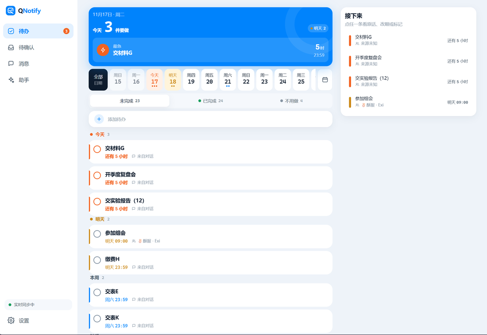
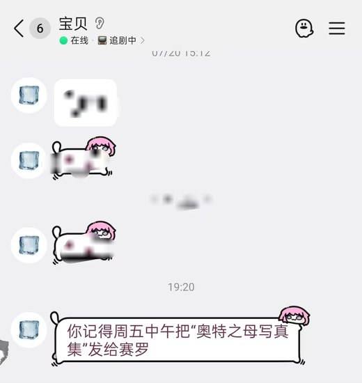
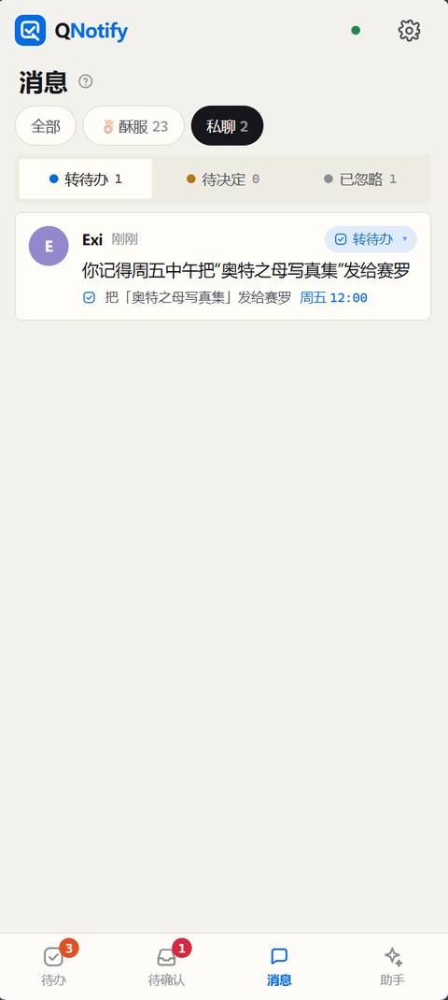
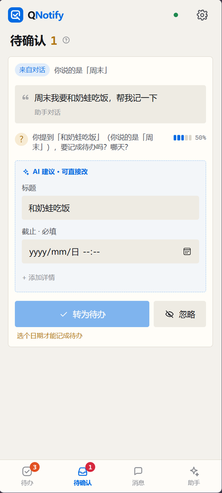
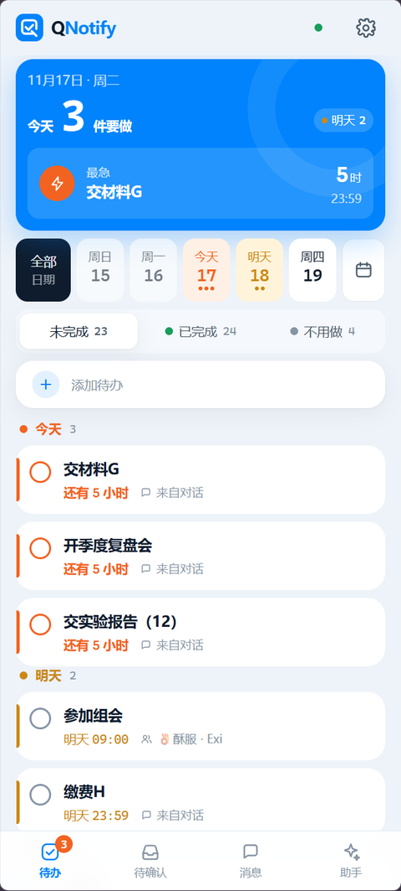
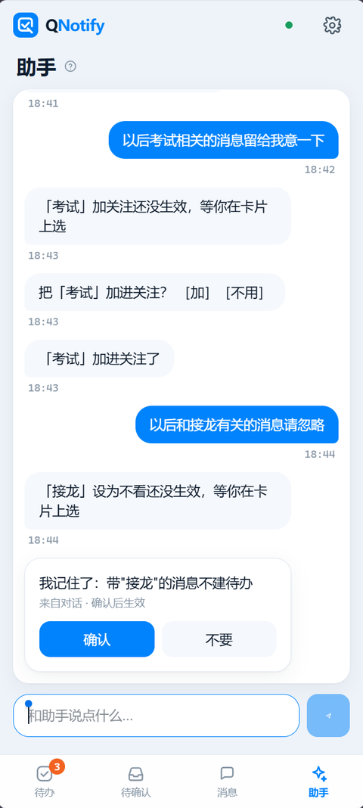
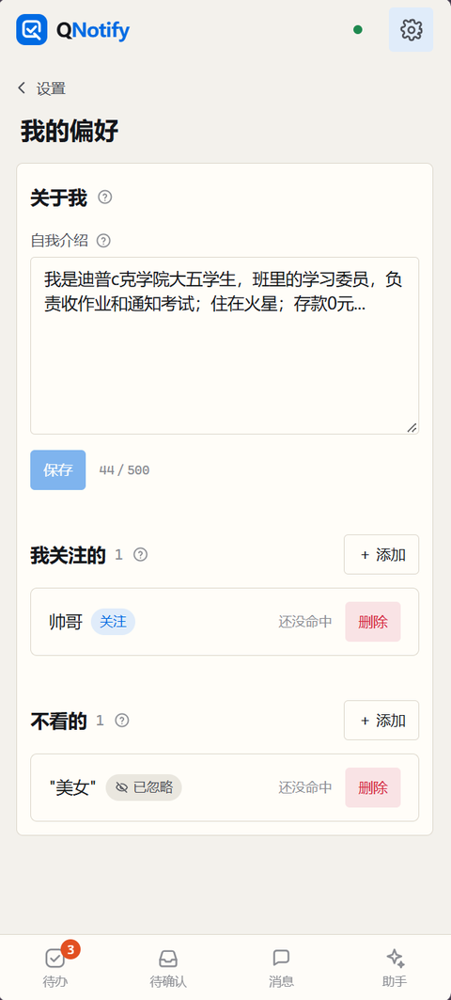
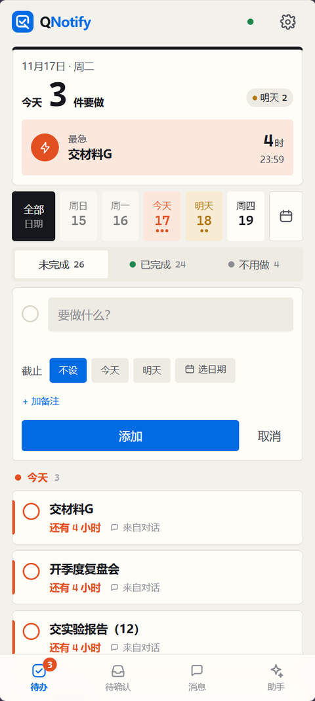
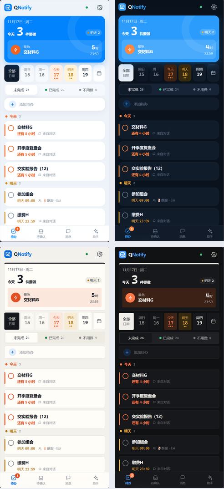

# QQ 通知管理器（QNotify）

把 QQ 群里真正需要你去做的事，自动变成待办。

它接在你自己安装的 QQ 协议端（NapCat / 任意兼容 OneBot 11 的实现）上，**只读**设定的白名单群/私信消息，
判断「这件事是什么、针对谁、有没有截止」，再由本地规则决定去向：

```
待办   ← 明确要求你做、且时间明确
待确认 ← 拿不准 / 对象不明 / 时间不明，交给你决定
忽略   ← 通知、闲聊、与你无关
```

所有数据留在本机 SQLite，不上传云端。



---

## 它解决什么问题

QQ 群消息大多是通知、接龙、闲聊和宣传，真正要你动手的事混在里面，很容易漏掉。

QNotify 不做聊天机器人，也不替你在群里说话。它只做三件事：

1. **捡出来**：明确要求你做、且时间明确的事 → 待办
2. **问一句**：拿不准的 → 待确认，由你确认或忽略
3. **记住偏好**：你在助手对话里说过的话会影响之后的判定

## 一条消息的旅程

QQ 里收到一条消息（这是大号发给小号的演示）：



程序读到之后，消息页里能看到它被判成了什么、要不要转待办：



拿不准的，交给你定——可以看原话、改标题、选日期；**没选日期不能转成待办**：



确定的事直接进待办：



## 在对话里定规矩

助手页不是只能聊天。你可以说「以后和考试相关的消息留意一下」，
它会问你一句，点一下卡片才生效：



三块偏好都在「设置 → 我的偏好」里：关于我、我关注的、不看的。



## 自己加一条

群里没提、系统漏判、临时想到的事，可以在待办页直接加。
手动添加允许不填截止时间——这是你自己的决定。



## 外观

两套主题 × 明暗两种模式，共四套：



## 功能

- **群消息 → 待办**：白名单群、判定模型 + 本地路由表，三档去向
- **待确认**：逐条确认，确认时可选日期
- **待办页**：今日焦点、列表、详情、状态流转、手动添加
- **助手页**：聊天/定待办/查询待办/建立用户偏好
- **确认卡**：意图不明确时出一张卡，点一下即处理
- **多账号**：第一个账号用主库，之后每个账号独立一个 SQLite 文件

## 架构

```
QQ 客户端
   │
   ▼
协议端（NapCat 等，需自行安装，不在本仓库内）
   │  OneBot 11 / WebSocket
   ▼
本程序后端（FastAPI + SQLite）
   ├── adapters/     协议端适配层（可插拔）
   ├── 判定链路      判定模型 → 本地路由表 → 用户规则
   ├── 对话链路      意图识别 → 执行器 → 回执 → 确认卡
   └── 本地 Web 前端（React）
```

设计原则：

- **模型只理解，程序做决定**：写不写、进哪一档由本地规则和回执决定
- **状态陈述只出自数据库回读**：界面上的「已加进关注了」来自写后回读，不是模型自述
- **时间不明确不建待办**：只进待确认（手动添加除外）
- **已生成的待办/待确认只由用户处理**：系统不做重判

## 快速开始

### 需要

- Python 3.12+ 与 [uv](https://github.com/astral-sh/uv)（uv 会自动选一个 3.12+ 的解释器）
- Node.js 20+ / pnpm（只在构建前端时需要）
- 一个 QQ 协议端（推荐 [NapCat](https://github.com/NapNeko/NapCatQQ)，需自行安装）

### 1. 安装协议端

按 NapCat 官方文档安装并登录你的 QQ，开启 **OneBot 11 WebSocket 服务**，记下地址与 token（常见默认 `ws://127.0.0.1:3001`）。

> 本仓库不包含、也不分发 NapCat 或其二进制文件。

### 2. 启动后端

```bash
cd server
uv sync
cp .env.example .env        # Windows: copy .env.example .env
# 编辑 .env，至少改 QN_ACCESS_TOKEN
uv run uvicorn app._asgi:app --host 127.0.0.1 --port 8720
```

### 3. 构建前端

```bash
cd web
pnpm install
pnpm build          # 产物在 web/dist
```

### 4. 打开

`vite preview` 自带 API / WebSocket 反代，一个端口就能用：

```bash
cd web
pnpm preview --port 5179
```

浏览器打开 `http://127.0.0.1:5179`：

1. 首次打开会要求「连接核心服务」：**服务地址**同源部署时留空，**访问令牌**填 `.env` 里的 `QN_ACCESS_TOKEN`
2. 「设置 → 白名单」选择要监听的群
3. 「设置 → 模型」填你自己的 LLM API

> 协议端地址不在界面里填，它由 `.env` 的 `QN_ADAPTER_WS_URL` 决定。
>
> 手机访问（同一局域网）：用 `pnpm preview --host --port 5179` 让预览监听局域网，
> 在 `.env` 的 `QN_CORS_ORIGINS` 里加上 `http://<电脑IP>:5179`，然后手机访问
> `http://<电脑IP>:5179`。跨网络需要自行做内网穿透或部署。

## 配置

后端通过环境变量或 `server/.env` 配置，前缀 `QN_`：


| 变量 | 说明 | 默认 |
| --- | --- | --- |
| `QN_ACCESS_TOKEN` | 访问本程序 UI/API 的令牌 | `change-me-before-first-run` |
| `QN_ADAPTER_WS_URL` | 协议端 OneBot WebSocket 地址 | `ws://127.0.0.1:3001/` |
| `QN_ADAPTER_TOKEN` | 协议端 token | 空 |
| `QN_DB_PATH` | 数据库路径 | `data/qnotify.db` |
| `QN_CORS_ORIGINS` | 额外的跨域来源（手机局域网访问时用） | 本机 5173 |

后端端口由启动命令的 `--port` 决定；模型、时区、判定参数在设置页或环境中配置。

**首次启动前必须修改 `QN_ACCESS_TOKEN`。**

> 令牌会出现在 WebSocket 查询串里，因此 uvicorn 的 access log 会记录它。
> 本机自用影响有限；不想留痕可在启动命令加 `--no-access-log`。

## 隐私与数据

- 所有群消息、待办、画像、规则都存在本机 SQLite（`server/data/`）
- 只有判定/对话时，消息片段会发送给你自己配置的模型服务商
- 仓库不包含任何真实聊天数据、账号、token；`server/data/` 已被 `.gitignore` 排除
- 协议端的登录凭证（如 NapCat 的 `accounts.json`）由协议端本地生成，不要提交到仓库

## 已知限制

- 必须自行安装并维护协议端；QQ 客户端升级可能导致协议端失效
- 使用第三方协议端存在账号风险（设备锁、验证、封禁等），请自行评估
- 目前是本地单机应用，没有安装包、没有手机原生 App
- 手机使用依赖局域网（按上面的预览+跨域方式），跨网络需自行穿透
- 判定质量取决于你配置的模型

## 项目结构

```
server/
  app/           FastAPI 应用、适配器、判定/对话链路、路由
web/
  src/           React + TypeScript + Tailwind
images/          README 截图
```

## 开发

```bash
# 后端：安装依赖后直接跑
cd server
uv sync
uv run uvicorn app._asgi:app --host 127.0.0.1 --port 8720

# 前端：开发模式（/api 代理到 8720）
cd web
pnpm install
pnpm dev
```

## 免责声明

- 本项目与腾讯、QQ、NapCat 均无关联，未获其背书
- 使用本项目可能违反相关服务条款，风险由使用者自行承担
- 请仅用于自己有权处理的群与消息
- 本项目按「现状」提供，不提供任何明示或暗示的担保

## 许可

[MIT](LICENSE)
